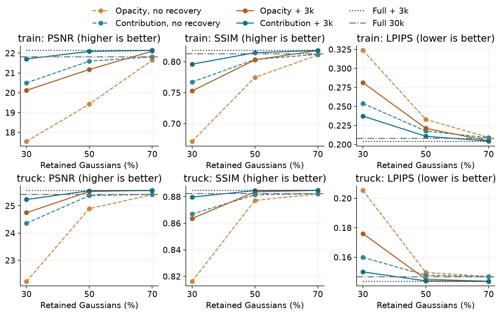
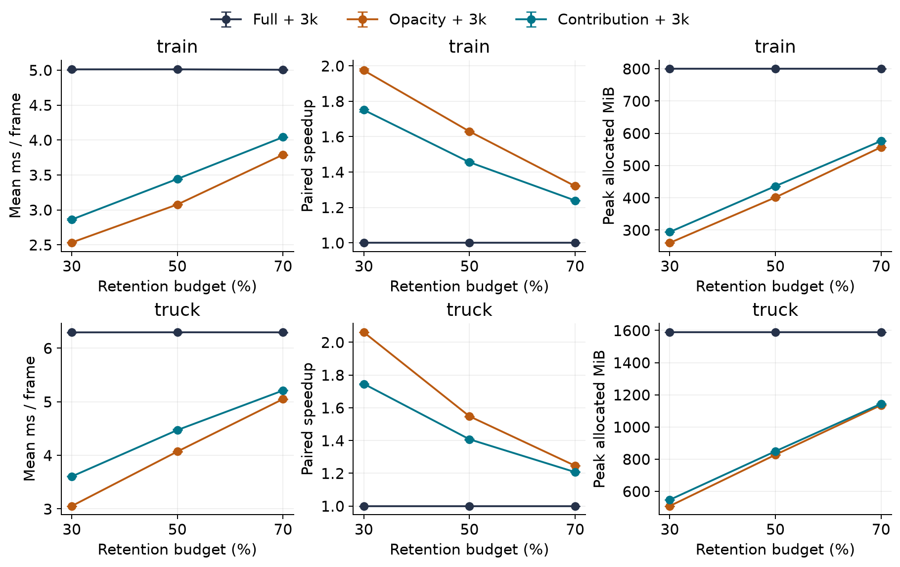
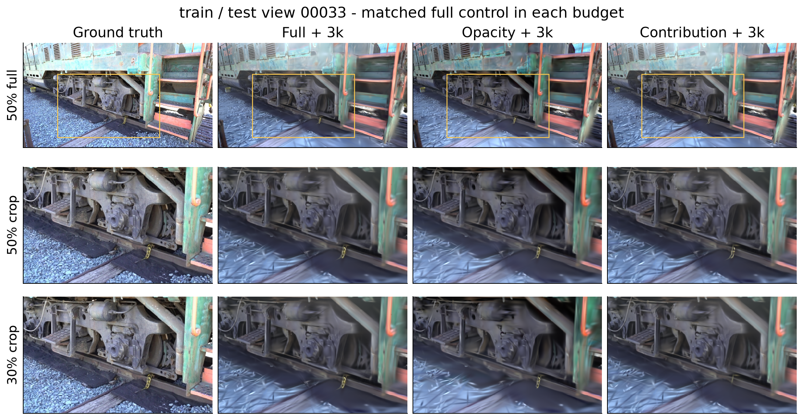
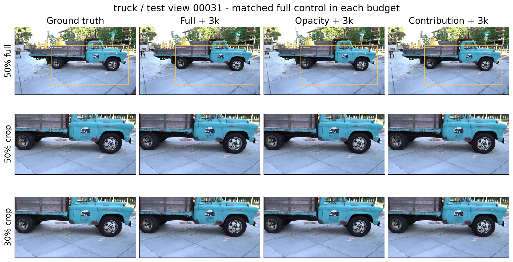

# 3DGS质量保持压缩：实验设计与结果

研究问题：已经训练好的3DGS场景，能否用更少的高斯、更小的模型，保留接近完整模型的新视角画质？本项目的压缩指选择高斯子集，不是文件打包，也不包含SH蒸馏或参数量化。

本文按研究问题组织已完成实验，每项说明目的、思路、配置、结果与结论。运行方法统一见[README](../README.md)，完整推导及图表见[技术报告](../output/pdf/3dgs_final_report.pdf)。下列质量数值来自实际测试视角均值，非论文参考值；最终性能采用独立重复计时，不混用早期单轮测速。

## 1. 共用实验协议

### 数据与baseline

使用作者预处理的Tanks and Temples数据，按固定相机顺序每8张留出一张测试视角；训练与贡献评分只使用训练视角。`train`指火车场景。

| 场景 | 训练/测试视角 | 实际渲染尺寸 | 原始高斯数 | PLY大小 |
| --- | ---: | --- | ---: | ---: |
| train | 263 / 38 | 980×545 | 1,082,124 | 255.94 MiB |
| truck | 219 / 32 | 979×546 | 2,590,158 | 612.60 MiB |

baseline固定官方提交 `2eee0e26d2d5fd00ec462df47752223952f6bf4e`，优化30,000步，seed=0，黑背景，分辨率参数为-1；其余采用该版本默认训练及密度控制流程。最终模型为SH3，PLY每行62个float32字段。

### 选点规则

- 保留数为 `max(1, floor(N × 保留率))`；预算为70%、50%、30%。
- 不透明度方法按raw opacity logit排序；sigmoid单调，因此与按激活透明度排序在数学上等价。
- 贡献度方法按训练视角平均可见混合权重排序，详见实验三。
- 并列时原始索引小者优先，选中后恢复原始行顺序，所有字段一起保留；不降低SH阶数或数值精度。
- 不同预算从同一完整baseline和同一份贡献评分独立选取，形成嵌套子集，不累计剪枝。

### 恢复训练配置

所有正式恢复均为3,000步，fresh Adam，seed=0，同一实验内使用相同训练相机序列（逐轮无放回打乱）。损失为 `0.8 × L1 + 0.2 × (1 − SSIM)`。优化位置、SH、透明度、尺度和旋转，但关闭增密、自动剪枝、opacity reset和SH升阶，保证数量固定。

| 参数组 | 固定学习率/设置 |
| --- | --- |
| 位置 | 1.6e-6 × 场景相机范围尺度 |
| SH直流 / 其余SH | 2.5e-4 / 1.25e-5 |
| 透明度 / 尺度 / 旋转 | 0.005 / 0.0005 / 0.0001 |
| Adam epsilon | 1e-15 |

完整模型也做同样的3k优化，以分离“额外训练的收益”和“压缩方法的收益”。不同预算任务各有自己的完整恢复对照，不能把其他批次的完整模型替代本任务对照。

### 指标与解释边界

PSNR、SSIM越高越好，LPIPS越低越好，均取全测试视角平均。模型大小指相同格式的PLY字节数，不是ZIP体积。最终计时采用CUDA事件测渲染器，不含模型加载、PNG保存或磁盘I/O；显存是PyTorch峰值分配量，不是整卡占用。完整计时协议见实验七。

质量实验为单种子，计时重复不是训练重复。测试图已用于诊断，50%工作点是观察后的工程推荐，不是独立验证集选出的最优参数；始终保留完整预算曲线，不主张微小分差的统计显著性。

## 2. 实验一：baseline与保存重载正确性

### 研究目的

建立画质基准，并确定文件处理本身不会改变渲染，避免把实现错误误认为剪枝损失。

### 实验思路与具体配置

先取得30k baseline，再令 `identity100` 保留全部高斯及原顺序，实际经历读取、写出、重载、渲染。逐字段检查float32位模式，并将train的38个测试视角GT和渲染PNG与baseline逐像素比较。此阶段不做梯度更新。

### 结果

| 场景/模型 | PSNR ↑ | SSIM ↑ | LPIPS ↓ |
| --- | ---: | ---: | ---: |
| train baseline / identity100 | 21.810524 | 0.812434 | 0.208012 |
| truck baseline | 25.417843 | 0.882305 | 0.146760 |

train的38视角PNG一致性检查通过，参数保存重载检查通过。truck的对应baseline在跨场景实验中建立。

### 结论

该处理链可以作为后续剪枝对照。PNG一致只证明量化后的输出一致，不等于证明量化前浮点张量逐位一致。baseline在车轮、细杆和地面部分区域已有模糊或伪影，压缩实验不能把它们全部视为新增错误。

## 3. 实验二：不透明度剪枝与短程恢复

### 研究目的

回答两个问题：只看高斯自身不透明度，删掉一半是否足够？若质量下降，让剩余高斯继续优化能补回多少？

### 实验思路与具体配置

train保留50%，即541,062个高斯、127.97 MiB。先不训练直接评测，再按共用3k配置恢复；同时给完整模型相同3k优化。共四组。这是早期独立批次，不与后续六组重跑混作同一次实验。

### 结果

| 模型 | PSNR ↑ | SSIM ↑ | LPIPS ↓ |
| --- | ---: | ---: | ---: |
| 完整 | 21.810524 | 0.812434 | 0.208012 |
| 不透明度50% | 19.424191 | 0.774688 | 0.232863 |
| 完整＋恢复 | 22.139515 | 0.818247 | 0.203941 |
| 不透明度50%＋恢复 | 21.175407 | 0.802914 | 0.221098 |

### 结论

直接剪枝损失2.3863 dB；恢复挽回约1.7512 dB，但相对原始baseline仍低0.6351 dB，相对同样恢复的完整模型低0.9641 dB。数量和文件大小不变，说明恢复确实改善了剩余高斯的拟合，但“删谁”仍然关键，不能只靠追加优化解决。

## 4. 实验三：可见贡献评分是否更会选点

### 研究目的

在不增加恢复训练的条件下，隔离评分规则的效果。

### 实验思路与具体配置

train、50%保留、0步恢复，比较完整、不透明度和贡献度三组。贡献度使用全部263个训练视角：

`s_i = mean_v [ sum_p T_vi(p) × alpha_vi(p) / P_v ]`

`alpha`是透明度与二维高斯响应的乘积，`T`是前方剩余透过率，`P_v`是该视角像素数。因此一个自身不透明却被遮住的高斯，评分仍可能很低。

实现中固定几何与透明度，暂用(0.5,0.5,0.5)诊断颜色和黑背景，对渲染RGB均值求颜色梯度；将三个通道梯度相加即可获得该视角平均混合权重。GPU梯度float32，跨视角累加float64。诊断颜色不写回模型，不读取测试GT。

数值关卡包括非负有限值、权重和与 `2 × 图像均值` 一致，以及首个训练视角固定索引子集的有限差分检查；正式结果均通过。

### 结果

| 模型 | PSNR ↑ | SSIM ↑ | LPIPS ↓ |
| --- | ---: | ---: | ---: |
| 完整 | 21.810524 | 0.812434 | 0.208012 |
| 不透明度50% | 19.424191 | 0.774688 | 0.232863 |
| 贡献度50% | 21.595947 | 0.803524 | 0.217566 |

### 结论

同样删掉一半且完全不恢复，贡献度比不透明度高2.1718 dB，距完整模型仅0.2146 dB，说明考虑可见性明显改善了train的选点。不过该评分只是可见权重代理量，不是“删除某点造成的真实误差”：删除会改变后方可见性，评分也没有建模颜色冗余。

## 5. 实验四：评分方法×恢复训练六组消融

### 研究目的

检验贡献评分和恢复是否互补，并排除“只是多训练了3k步”的解释。

### 实验思路与具体配置

train、50%预算，完整/不透明度/贡献度分别搭配0步或3k恢复，共六组。三组恢复重新建立优化器，使用相同相机序列和共用配置。以下为最终六组批次，早期实验二的22.139515与21.175407不替换这里的对应数值。

### 结果

| 模型 | PSNR ↑ | SSIM ↑ | LPIPS ↓ |
| --- | ---: | ---: | ---: |
| 完整 | 21.810524 | 0.812434 | 0.208012 |
| 不透明度50% | 19.424191 | 0.774688 | 0.232863 |
| 贡献度50% | 21.595947 | 0.803524 | 0.217566 |
| 完整＋恢复 | 22.139402 | 0.818250 | 0.203952 |
| 不透明度50%＋恢复 | 21.175035 | 0.802914 | 0.221105 |
| 贡献度50%＋恢复 | 22.086800 | 0.814473 | 0.210707 |

### 结论

贡献度恢复比贡献度无恢复增加0.4909 dB，比不透明度恢复高0.9118 dB；相对同预算完整恢复仅低0.0526 dB。两部分具有互补作用。但SSIM仍低0.003777，LPIPS仍高0.006755，不能只凭PSNR接近宣称完全无损。

## 6. 实验五：truck跨场景复现

### 研究目的

检查结论是否只在火车场景成立，以及不同场景对选点方法的敏感度。

### 实验思路与具体配置

冻结50%预算、3k恢复、学习率、损失和评分公式，迁移到truck；贡献评分使用其全部219个训练视角，评测32个测试视角。保留1,295,079个高斯，PLY 306.30 MiB。只在同场景内部比较，不把train和truck的绝对FPS差异当作算法优劣。

### 结果

| 模型 | PSNR ↑ | SSIM ↑ | LPIPS ↓ |
| --- | ---: | ---: | ---: |
| 完整 | 25.417843 | 0.882305 | 0.146760 |
| 不透明度50% | 24.896971 | 0.877248 | 0.149610 |
| 贡献度50% | 25.374870 | 0.881424 | 0.147770 |
| 完整＋恢复 | 25.561270 | 0.884787 | 0.143576 |
| 不透明度50%＋恢复 | 25.524910 | 0.883636 | 0.145088 |
| 贡献度50%＋恢复 | 25.552813 | 0.884649 | 0.143931 |

### 结论

贡献恢复与完整恢复仅差0.0085 dB；但不透明度恢复也只差0.0364 dB，两种恢复方法相差约0.0279 dB。该场景压缩容忍度较高，贡献评分的增益远小于train，不能把单场景的明显收益推广为普遍优势。

## 7. 实验六：70% / 50% / 30%预算曲线

### 研究目的

确定温和压缩与激进压缩的边界，而不是仅展示一个有利工作点。

### 实验思路与具体配置

两场景分别补齐70%与30%，每个预算仍为六组，恢复配置不变；与既有50%构成36组质量记录。每预算复用完整baseline与全训练视角评分，完整恢复对照在本任务独立执行。

### 结果：新增预算全部质量组

| 场景 | 保留率 | 方法 | PSNR ↑ | SSIM ↑ | LPIPS ↓ |
| --- | ---: | --- | ---: | ---: | ---: |
| train | 70% | 完整 | 21.810524 | 0.812434 | 0.208012 |
| train | 70% | 不透明度 | 21.639704 | 0.810675 | 0.209124 |
| train | 70% | 贡献度 | 21.807867 | 0.811881 | 0.208663 |
| train | 70% | 完整＋恢复 | 22.139441 | 0.818239 | 0.203945 |
| train | 70% | 不透明度＋恢复 | 22.098965 | 0.817956 | 0.204686 |
| train | 70% | 贡献度＋恢复 | 22.140268 | 0.818075 | 0.204394 |
| train | 30% | 完整 | 21.810524 | 0.812434 | 0.208012 |
| train | 30% | 不透明度 | 17.542755 | 0.671249 | 0.323712 |
| train | 30% | 贡献度 | 20.497404 | 0.767161 | 0.253825 |
| train | 30% | 完整＋恢复 | 22.139246 | 0.818241 | 0.203946 |
| train | 30% | 不透明度＋恢复 | 20.118963 | 0.752698 | 0.281305 |
| train | 30% | 贡献度＋恢复 | 21.707100 | 0.795929 | 0.237188 |
| truck | 70% | 完整 | 25.417843 | 0.882305 | 0.146760 |
| truck | 70% | 不透明度 | 25.408709 | 0.882120 | 0.146921 |
| truck | 70% | 贡献度 | 25.418036 | 0.882290 | 0.146788 |
| truck | 70% | 完整＋恢复 | 25.561222 | 0.884786 | 0.143570 |
| truck | 70% | 不透明度＋恢复 | 25.566845 | 0.884764 | 0.143655 |
| truck | 70% | 贡献度＋恢复 | 25.561291 | 0.884786 | 0.143582 |
| truck | 30% | 完整 | 25.417843 | 0.882305 | 0.146760 |
| truck | 30% | 不透明度 | 22.225498 | 0.816180 | 0.205360 |
| truck | 30% | 贡献度 | 24.360453 | 0.866919 | 0.159902 |
| truck | 30% | 完整＋恢复 | 25.561100 | 0.884788 | 0.143576 |
| truck | 30% | 不透明度＋恢复 | 24.747164 | 0.863592 | 0.176016 |
| truck | 30% | 贡献度＋恢复 | 25.231970 | 0.879736 | 0.150025 |

### 结果：贡献恢复相对同预算完整恢复

| 场景 | 保留率 | 高斯数 | PLY MiB | ΔPSNR | ΔLPIPS |
| --- | ---: | ---: | ---: | ---: | ---: |
| train | 70% | 757,486 | 179.16 | +0.000828 | +0.000450 |
| train | 50% | 541,062 | 127.97 | -0.052603 | +0.006755 |
| train | 30% | 324,637 | 76.78 | -0.432146 | +0.033242 |
| truck | 70% | 1,813,110 | 428.82 | +0.000069 | +0.000012 |
| truck | 50% | 1,295,079 | 306.30 | -0.008457 | +0.000355 |
| truck | 30% | 777,047 | 183.78 | -0.329130 | +0.006449 |

### 结论

70%为保守压缩，质量几乎保持；微小正PSNR不足以支持可靠提升。50%在本项目中兼顾模型减半与较小质量损失，适合作为主要展示工作点。30%提供约3.33倍PLY压缩，但train感知质量下降明显，不能称近乎无损。

30%时贡献恢复比不透明度恢复的PSNR分别高1.5881 / 0.4848 dB；70%的truck却是不透明度略高，差仅0.0056 dB。复杂评分的收益随预算和场景变化。

## 8. 实验七：独立重复计时与资源收益

### 研究目的

验证速度收益可重复，并检查减少高斯数量是否等比例减少渲染成本。

### 实验思路与具体配置

两场景×三预算×三个恢复后模型（完整、不透明度、贡献度），共18设置，各3个独立进程，合计54份样本。同主机、同作业完成。每进程预热20帧，再遍历全部测试视角3次；方法顺序按轮次轮换。

统计单位是每进程的平均帧耗时，报告3个均值的中位数；先在同一轮计算完整/压缩耗时比，再对3个比值取中位数。范围为最小到最大，不是置信区间。10%相对耗时范围仅作为工程排错线。

### 结果

下表均为恢复后模型；显存单位MiB，是三进程峰值分配量的中位数。

| 场景 | 保留率 | 完整 ms | 不透明度 ms / 加速比 | 贡献度 ms / 加速比 | 完整 / 不透明度 / 贡献度显存 |
| --- | ---: | ---: | --- | --- | --- |
| train | 70% | 5.0063 | 3.7900 / 1.321× | 4.0411 / 1.239× | 799.98 / 556.93 / 576.23 |
| train | 50% | 5.0120 | 3.0773 / 1.630× | 3.4430 / 1.456× | 799.98 / 401.38 / 436.29 |
| train | 30% | 5.0116 | 2.5334 / 1.974× | 2.8624 / 1.751× | 799.98 / 260.48 / 294.15 |
| truck | 70% | 6.2962 | 5.0501 / 1.246× | 5.2107 / 1.207× | 1590.56 / 1135.69 / 1144.05 |
| truck | 50% | 6.2970 | 4.0711 / 1.548× | 4.4722 / 1.408× | 1590.56 / 827.34 / 849.11 |
| truck | 30% | 6.2954 | 3.0537 / 2.061× | 3.6053 / 1.746× | 1590.56 / 508.74 / 547.53 |

54份样本与18组汇总复算通过，最大 `(最大均值−最小均值)/中位数` 为0.53584%。50%贡献恢复对应约290.44 / 223.60 FPS，但该数值不是交互查看器端到端FPS。

### 结论

独立复测支持现有速度结论，无需因本次计时噪声追加复测。同数量下不透明度方法始终更快；保留点的屏幕覆盖和混合负担不同，点数与耗时不成正比。贡献度用一定推理成本换取部分预算下更好的质量，不能宣称全面占优。

## 9. 实验八：额外优化开销与定性诊断

### 研究目的

补足平均画质和推理FPS看不到的代价与失败区域，判断压缩的实际取舍。

### 实验思路与具体配置

汇总已有正式实验的评分和恢复计时，不新增训练。每场景评分只做一次并共享给三个预算。固定观察train的00014/00033、truck的00014/00031，GT、同预算完整恢复、不透明度恢复、贡献度恢复使用相同裁剪区域；同时展示50%与30%，不挑每种方法最有利的视角。

### 开销结果

| 场景 | 保留率 | 共享评分 s | 完整恢复 s | 不透明度恢复 s | 贡献度恢复 s |
| --- | ---: | ---: | ---: | ---: | ---: |
| train | 70% | 3.115 | 58.458 | 46.264 | 48.385 |
| train | 50% | 3.115 | 58.463 | 36.075 | 41.357 |
| train | 30% | 3.115 | 58.503 | 27.955 | 34.027 |
| truck | 70% | 3.245 | 89.141 | 69.387 | 70.463 |
| truck | 50% | 3.245 | 89.098 | 54.223 | 58.337 |
| truck | 30% | 3.245 | 89.103 | 38.284 | 44.994 |

评分行重复列出便于比较，不能把它累加三次。这些内部计时不含完整的加载、检查点/最终模型写入与评测开销，不是作业墙钟时间，也未做独立多轮开销复测。

### 视觉结果与结论

- train 00014：关注车体边缘、轮轨和地面高频结构；激进压缩下细节更平滑，平均PSNR接近不代表所有边缘一致。
- train 00033：轮组、链条等结构有模糊；地面尖锐条纹在完整模型中也存在，主要是baseline重建失败，固定数量恢复不能凭空补齐表达能力。
- truck 00014/00031：50%两方法整体都接近完整模型；30%主体仍清楚，小纹理和地面更平滑，与指标变化方向一致。

这些视角是公开的诊断样本，不是盲评或随机抽样，不能代替全测试视角指标。压缩有效的证据是“资源下降且损失可量化”，不是把重建失败隐藏掉。

## 10. 总结与证据索引

主结论是：训练视角贡献评分与固定数量恢复在本项目的两个场景上形成可解释的画质—资源折中。50%是适合展示的工程工作点，70%展示保守边界，30%展示更强压缩的代价。当前结果不支持跨所有场景泛化、微小差异显著或全维度最优等主张。

实验范围已经覆盖baseline、正确性、评分消融、恢复消融、跨场景、预算曲线、独立计时与失败分析；没有实质缺陷时不再默认增加训练。后续若换数据、方法或配置，应作为新实验独立记录，不能覆盖旧证据。

| 实验 | 原始证据（相对仓库根目录） |
| --- | --- |
| train baseline | `results/train-4090d-30k-first` |
| 保存重载/不透明度 | `results/train-opacity-phase1-first` |
| 早期恢复四组 | `results/train-recovery3k-first` |
| 贡献评分三组 | `results/train-contribution50-first` |
| 最终50%六组 | `results/{train,truck}-scoring-recovery3k-first` |
| 70%与30%六组 | `results/{train,truck}-budget{70,30}-recovery3k-job4371574` |
| 独立重复计时 | `results/timing-repeat-job4380448` |
| 统一数据审计 | `report/generated/audit.json` |

最终六个质量目录共核对36组均值、18组训练记录、210张图片哈希和180张渲染像素PSNR；54份重复计时样本及来源对应通过。此核查基于云端导出证据，本地没有重新执行GPU训练、SSIM/LPIPS或读取未上传的完整PLY。

历史首次评测曾因缺失 `white_background` 配置失败，修正后重新执行正式评测；失败输出未当作实验结果。早期记录与旧操作说明保留在Git历史，不再与本研究正文混排。
